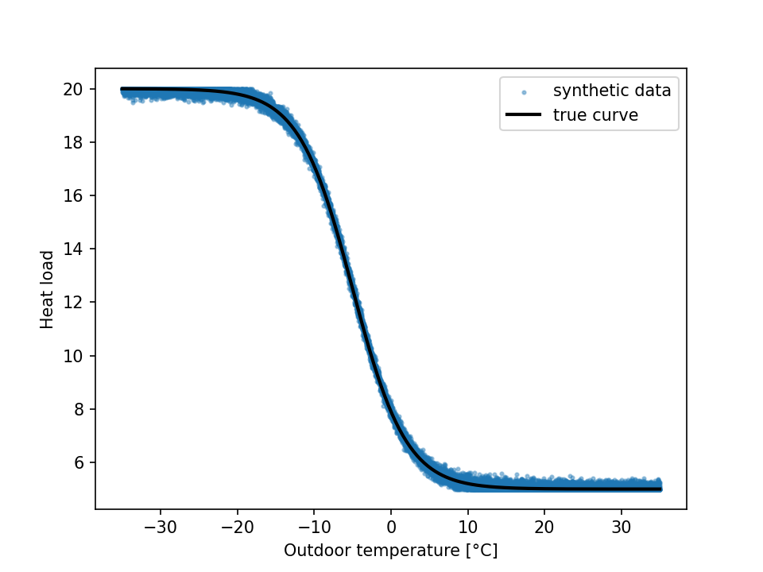
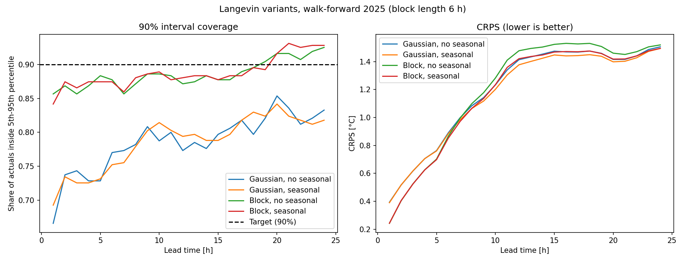
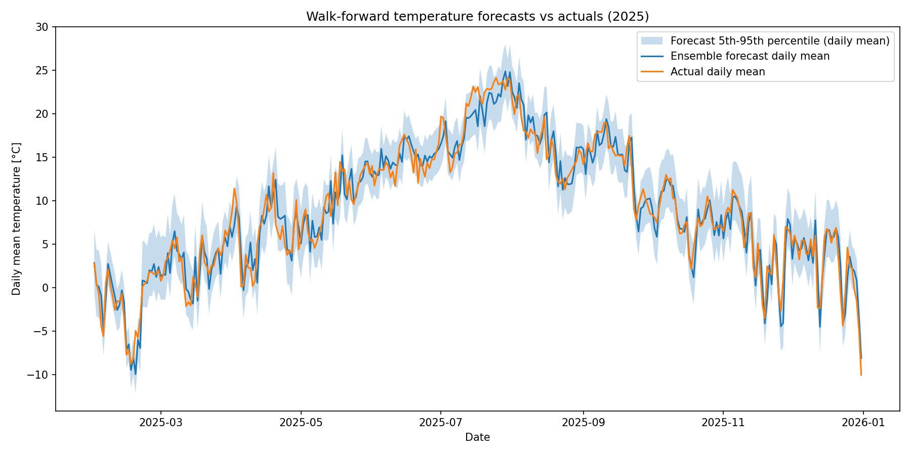
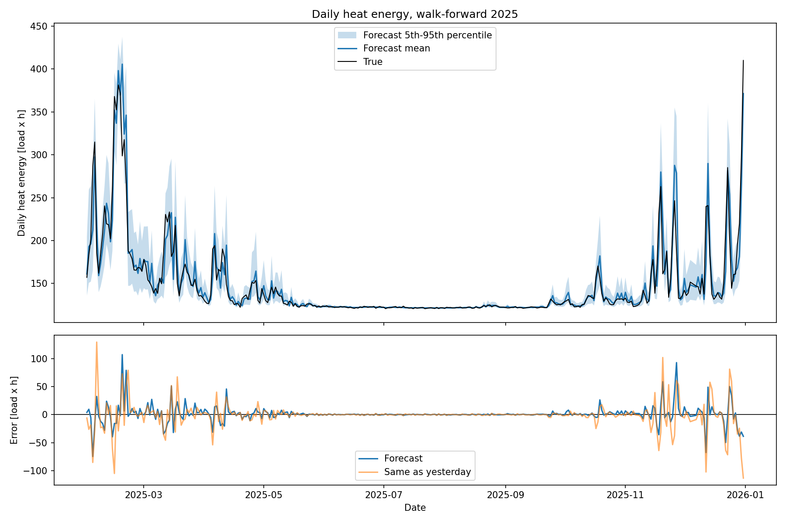

# Day-ahead heat load forecast for Helsinki

Probabilistic 24-hour forecast of outdoor temperature at Helsinki Kaisaniemi,
converted into a heat load forecast. Every forecast is an ensemble of 2,000
simulated days, so it gives an uncertainty band as well as a point estimate.
Everything is evaluated walk-forward over all of 2025: each day is forecast
only from data before it.

| 2025, walk-forward | Hourly MAE | 90% band coverage | Daily energy error |
|---|---|---|---|
| Temperature | 1.60 °C | 88.8% | – |
| Heat load | 0.42 | 92.4% | 3.9% (vs 5.8% for "same as yesterday") |
| Heat load, days below 0 °C | 1.63 | 77.5% | 11.7% (vs 16.6%) |

**Note:** no real heat load data was available. The heat load is synthetic: an
assumed logistic curve of outdoor temperature (see
[Heat load](#heat-load)). The heat load results therefore show how well
temperature uncertainty carries through to load, not how well real
consumption is predicted.

## Quick start

```bash
pip install -r requirements.txt

python predict_heat_load.py --date 2025-12-23       # forecast one day
python compare_temperature_forecast.py --date 2025-12-23

python evaluate_yearly_temperature_forecasts.py     # temperature, all of 2025
python compare_langevin_variants.py                 # noise model x seasonal forcing
python evaluate_yearly_heat_load_forecasts.py       # heat load, all of 2025
```

All outputs go to `results/`, which is not tracked by git. The plots shown in
this README are copies of those outputs, kept in `figures/`. The yearly scripts
take a few minutes each.

## Layout

| Path | Contents |
|---|---|
| `predict_heat_load.py` | Temperature model, heat load conversion, single-day forecast |
| `heat_load_synth.py` | Generates the synthetic temperature to load data |
| `evaluate_yearly_temperature_forecasts.py` | Walk-forward temperature evaluation; shared evaluation helpers |
| `compare_langevin_variants.py` | Compares Gaussian and block noise, each with and without seasonal forcing |
| `evaluate_yearly_heat_load_forecasts.py` | Walk-forward heat load evaluation against a "same as yesterday" baseline |
| `compare_temperature_forecast.py` | Plots one saved forecast against the observations |
| `data/` | FMI hourly temperatures 2023-2025 (UTC) and the synthetic load data |
| `figures/` | The plots shown in this README |
| `results/` | Outputs of the scripts above (created on first run, not tracked) |

## Data

- **Temperature:** hourly mean temperature at Helsinki Kaisaniemi, from
  Finnish Meteorological Institute open data, 2023-2025, in UTC.
  - 2025 is forecast and evaluated.
  - 2023-2024 are used only to fit the seasonal baseline, so the evaluation
    never sees 2025 data through it.
- **Heat load:** 14,000 synthetic samples, generated by
  `load = 5 + 15 / (1 + exp((T + 5) / 3.5))` plus Gaussian noise with a
  standard deviation of 1% of the load range, clipped to [5, 20].



## Method

### Temperature model

The temperature is split into three parts:

```
T(t) = B(t) + μ(h) + a(t)
```

| Term | Meaning | Fitted from |
|---|---|---|
| `B(t)` | Seasonal baseline: least-squares climatology with annual and daily harmonics, and a daily cycle whose size changes with the season (17 terms) | 2023-2024 |
| `μ(h)` | How far recent weather is from the seasonal norm, per hour of day; recency-weighted mean of `T − B` with a 5-day half-life | Previous 30 days |
| `a(t)` | Anomaly, a mean-reverting Langevin (Ornstein-Uhlenbeck) process | Previous 30 days |

The anomaly follows `da = −θ a dt + σ dW`. With hourly steps this is exactly

```
a_k = φ a_(k−1) + ε_k,     φ = exp(−θ)
```

where φ is a least-squares fit on consecutive anomalies. The median φ in 2025
is about 0.985, so an anomaly halves in roughly two days. `B(t)` moving with
the season acts as a forcing term in the drift.

**Noise.** The errors `ε_k` are not drawn from a Gaussian. They are copied
from the model's own past errors in the 30-day window, in **6-hour blocks
aligned to the hour of day**. Each member builds its day from 4 blocks taken
from randomly chosen past days. Copying runs of consecutive errors keeps
three properties of real errors that independent Gaussian draws lose:

- **Correlation between hours.** Consecutive errors have r ≈ 0.41, and after
  6 hours the accumulated error varies twice as much as independent draws
  imply.
- **Heavy tails.** Large errors happen more often than a Gaussian allows.
- **Hour-of-day pattern.** Morning errors are larger than night errors.

### Heat load

Each simulated temperature is mapped to a load by drawing a random synthetic
sample within ±0.5 °C. The heat load ensemble therefore carries both the
temperature uncertainty and the noise in the load data. Temperatures outside
the synthetic range (−35 to 35 °C) are clipped to its edge, which is exact
because the curve is flat there.

### Evaluation

- **Walk-forward:** each of the 335 days from 31 January to 31 December 2025
  (the first 30 days lack history) is forecast from the 30 days before it.
- **Metrics:**
  - MAE, RMSE and bias of the ensemble mean.
  - CRPS, which scores the whole forecast distribution.
  - Coverage: the share of observations inside the 50% and 90% bands.
- **Comparing variants:** all variants use the same random seed per day. CRPS
  differences have 95% confidence intervals from a paired bootstrap that
  resamples whole days.
- **Heat load reference:** generated from the observed temperature in the
  same way as the synthetic data. The baseline is the load 24 hours earlier
  ("same as yesterday").

## Results

### Temperature

| Variant | MAE °C | CRPS °C | 50% coverage | 90% coverage | 90% band width °C |
|---|---|---|---|---|---|
| Gaussian noise, no seasonal forcing | 1.629 | 1.191 | 42.1% | 78.6% | 5.39 |
| Gaussian noise, seasonal forcing | 1.605 | 1.174 | 42.1% | 78.6% | 5.32 |
| Block noise, no seasonal forcing | 1.658 | 1.201 | 50.9% | 88.6% | 7.25 |
| **Block noise, seasonal forcing (used)** | **1.601** | **1.167** | **51.9%** | **88.8%** | 7.15 |

- **Seasonal forcing** removes most of the seasonal bias. Spring forecasts
  were 0.2 °C too cold and autumn forecasts 0.3 °C too warm. It lowers MAE by
  about 1.5%.
- **Block noise** fixes the band coverage, from 79% to 89% for the 90% band.
  It is the main improvement.
- **The CRPS gain** of the chosen variant over the plain Gaussian model is
  −0.024 °C, with a 95% confidence interval of [−0.055, +0.007]. That makes
  it probably better, not certainly.





### Heat load

| | All days | Days below 0 °C |
|---|---|---|
| Hourly load MAE (same as yesterday) | 0.42 (0.62) | 1.63 (2.34) |
| Hourly 90% coverage | 92.4% | 77.5% |
| Daily energy error (same as yesterday) | 3.9% (5.8%) | 11.7% (16.6%) |
| Daily energy 90% coverage | 91.3% | 84.8% |

Almost all of the load error falls between November and March. From May to
September the load sits at its floor, so temperature errors barely matter.


